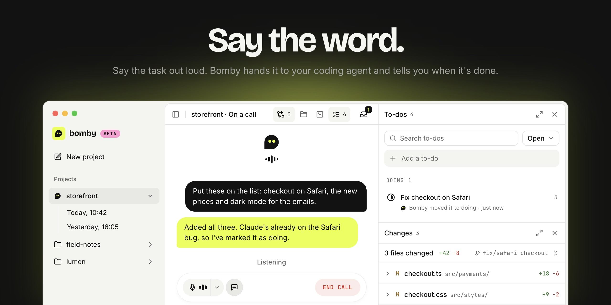

<p align="center">
  
</p>

# Bomby

**Stop typing. Start talking.**

Bomby is a desktop app you talk to. Say what you want done, and Bomby hands it to the agent on your computer, keeps the conversation going while it works, and tells you how it went. You can start several things at once, add to a task while it's running, and pick up an earlier call where you left off.

Bomby is in beta and runs on macOS.

## How it works

1. **You talk.** Start a call on a project. Bomby listens and answers out loud, using Gemini Live through LiveKit.
2. **Your agent works.** Real work goes to an agent installed on your computer, in the project's folders, over the [Agent Client Protocol](https://agentclientprotocol.com) (ACP). Each piece of work gets its own session, and sessions run side by side.
3. **You hear the result.** When the agent finishes, Bomby tells you what happened. The tasks panel in the call shows what each agent is doing.

Every call is saved with its transcript, so you can read it back or resume it later.

## Agents

Bomby finds these on your computer by itself and lists them in Settings > Agents:

| Agent | How Bomby runs it |
| --- | --- |
| [Claude Code](https://claude.com/product/claude-code) | through `claude-agent-acp`, on your own Claude plan |
| [OpenCode](https://opencode.ai) | `opencode acp` |
| [goose](https://goose-docs.ai) | `goose acp` |
| [omp](https://github.com/can1357/oh-my-pi) | `omp acp` |

Claude is the default; ask for another one by name ("ask goose to..."). Each agent works with your own setup: your accounts, models and rules.

## What you need

- A Mac
- A [LiveKit Cloud](https://cloud.livekit.io) project (the free tier is enough): its URL, API key and API secret
- A [Gemini API key](https://aistudio.google.com/apikey)
- At least one agent from the list above. No agent yet? Install Claude Code:

  ```bash
  curl -fsSL https://claude.ai/install.sh | bash
  ```

Your keys stay in your macOS keychain. Bomby never sees or stores your agents' logins.

## Run it

Bomby isn't packaged yet, so for now it runs from source. You need [mise](https://mise.jdx.dev) and [just](https://just.systems).

```bash
just install    # the pinned tools (mise) and every part's dependencies
just app dev    # start the app
```

Then open Settings, paste your LiveKit and Gemini keys under Credentials, and check that Setup and Agents look ready. Add a project with its folders and start a call.

### Without the app

You can also talk to the voice agent straight from your terminal, with no app and no LiveKit project:

```bash
cp agent/.env.example agent/.env    # add your GOOGLE_API_KEY
just agent console                  # talk out loud
just agent console-text             # or type
```

## Good to know

- **Agents run with full access.** Permissions are bypassed in every agent, so they can work anywhere on your computer. A project's folders tell an agent where to work; they don't fence it in.
- **Use wired headphones or speakers.** With Bluetooth headphones as the output, the voice can pick itself up and answer itself.
- **Long calls.** Gemini Live sessions are limited in length; a very long call may drop and need resuming.

## For developers

| Path | What's there |
| --- | --- |
| `app/` | The desktop app: Tauri v2, a React frontend in `src/`, a Rust core in `src-tauri/` |
| `agent/` | The voice agent: Python, LiveKit Agents and Gemini Live. `harnesses/` defines each agent, `acp_client/` runs them, `tools/` is what the voice can do |
| `docs/` | Architecture, roadmap, decisions and notes on every library we rely on |

```bash
just          # every command
just check    # lint, types and tests in every part: what each change must pass
```

Start with [docs/AGENTS.md](docs/AGENTS.md), then [docs/architecture.md](docs/architecture.md) and [docs/roadmap.md](docs/roadmap.md). Adding another ACP agent is a few lines; see [the decision on detecting agents](docs/decisions/detect-acp-native-agents.md).

Bomby is built on [LiveKit](https://livekit.io) and [Gemini Live](https://ai.google.dev/gemini-api/docs/live), and works with the agents above. It isn't affiliated with any of them.

## License

The code is [MIT](LICENSE). Bomby™, its wordmark, the Dot Dot logo and the app icons are trademarks and aren't covered by the license: a fork you share needs its own name and brand. See [TRADEMARKS.md](TRADEMARKS.md).
