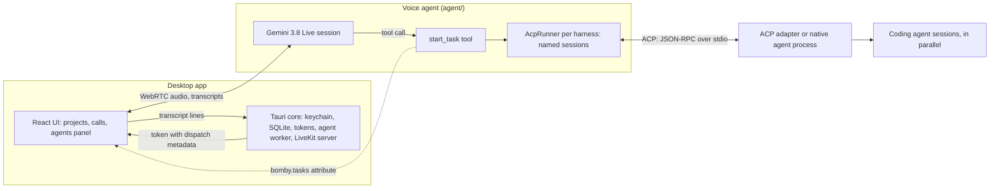

# Architecture

Bomby is a desktop app for talking to coding agents. A call connects Gemini's voice model to an agent installed on the user's machine. The user brings their Gemini key and their own agent ([decision](decisions/users-bring-their-own-keys-and-claude.md)); calls run through LiveKit on their Mac, or their own LiveKit Cloud project ([decision](decisions/livekit-on-this-mac-or-cloud.md)).

## The pieces

| Piece | Where | Status |
| --- | --- | --- |
| Voice agent | `agent/`: Python, LiveKit Agents, Gemini 3.8 Live | Built |
| Harnesses | `agent/harnesses/`: Claude Code, Codex, OpenCode, omp and goose; shared ACP client and runner in `agent/acp_client/`; one voice tool, `start_task` | Built |
| Desktop app | `app/`: Tauri v2, React, LiveKit Agents UI; settings, projects, calls and saved transcripts | In progress; runs the agent from source in dev, the packaged agent in release builds |
| App data | One core-owned SQLite database for projects, calls and messages | Built ([decision](decisions/app-data-in-one-sqlite-db.md)) |
| Packaging | The agent frozen with PyInstaller into the app's resources; adapters installed on Set up | Bundled in release builds; signed and notarized by the Release workflow ([releasing.md](releasing.md), [decision](decisions/ship-the-agent-and-adapter-as-sidecars.md)) |
| LiveKit server | Bundled `livekit-server` run by the core on this Mac (`livekit.just`, `src-tauri/src/local_server.rs`), or the user's LiveKit Cloud or own server; not needed for `just agent console` | Built |



## A call, start to end

1. **Start.** The core makes sure the call's LiveKit server runs (this Mac's, started on the first call, or the user's own), starts or restarts the agent worker on it, looks for the installed agents (leaving out any the setup probe found not set up) and records the call with `open_call`, then mints a read-only token with `call_token`. The token's room configuration dispatches `bomby` with the project, its folders and instructions, and the agents found when the call opened as job metadata; every token for the call carries the same server, agents and picks. The entrypoint reads `ctx.job.metadata`.
2. **Talk.** Gemini 3.8 Live handles speech both ways. Its instructions are the prompt for the user's tone (`agent/prompts/sharp.md`, `chatty.md` or `playful.md`) plus what the call adds, each part left out when it has nothing to say: what to call the user (`## The user`), the agents it can use, the project's instructions (`## Project context`) and, on a resumed call, the earlier conversation (`agent/voice_prompt.py`).
3. **Work.** Gemini calls `start_task(task, session, agent)`. Its first `ctx.update()` makes the tool non-blocking, so the conversation continues.
4. **Agent sessions.** Each selected harness gets one `AcpRunner` and one ACP process per call, started on its first task. A new session name opens a session; a known name continues it. Sessions run in parallel, and supported harnesses accept steering mid-turn.
5. **Result.** The agent's final message becomes the tool result. Gemini reads it out; no other agent output reaches the voice conversation.
6. **Saved.** The page sends each transcript line to the core as it arrives. The core upserts it by LiveKit segment id, and saved calls replay through the same transcript component.
7. **End.** Room disconnect stamps `ended_at`; the agent closes its sessions and ACP processes. The worker stays warm until the app quits.

## Data the app keeps

The app data folder (`~/Library/Application Support/app.bomby.desktop` on macOS) holds `bomby.db`: `projects`, `calls`, `messages`, `settings`, and the settings picked for each agent (`agent_picks`). LiveKit does not retain transcripts. Secrets stay in the OS keychain. The sidebar renders the project-and-call tree ([decision](decisions/sidebar-tree-of-projects-and-calls.md)).

## Contracts

**Job metadata** (app to agent, JSON in dispatch, up to 512 KiB):

```json
{
  "project": "samba",
  "folders": ["/Users/me/Dev/samba", "/Users/me/Dev/shared"],
  "instructions": "A music app: the API is in Go, the site in Svelte.",
  "agents": {"claude": "/Users/me/.local/bin/claude", "opencode": "/Users/me/.opencode/bin/opencode"},
  "picks": {"claude": [{"setting": "model", "value": "opus"}], "opencode": [{"setting": "model", "value": "provider/model-id"}]},
  "voice": "Leda",
  "user_name": "Sam",
  "tone": "chatty",
  "history": [{"role": "user", "text": "fix the login"}, {"role": "agent", "text": "Claude's on it."}]
}
```

- All fields are optional; one sent as null counts as left out, and unknown fields are ignored. `folders` must be absolute, existing paths; the first is the working directory and the rest become ACP `additionalDirectories`. Defaults are the home folder, project `home`, and voice `GEMINI_VOICE` or Leda.
- `instructions` is what the user wrote about the project in its settings, up to 5,000 characters; empty when they wrote nothing, and then neither the voice model nor the coding agents hear of it.
- `agents` maps installed harness ids to programs: all but those the setup probe found not ready (one not probed yet stays). The voice model can use only agents in this list; console runs find them on PATH ([decision](decisions/detect-acp-native-agents.md)).
- `picks` holds the session settings the user picked for each agent, if any (model, effort, goose's provider), which the runner applies to every session it opens with `session/set_config_option`, in the agent's own order (provider before model). One the agent no longer offers, or refuses, is skipped, leaving its default; for an agent whose harness requires a model pick, a session without one fails the task (`no_model_picked`) ([decision](decisions/pick-agent-settings-like-buzz-and-zed.md)).
- `tone` is `sharp` (the default), `chatty` or `playful`, from Settings, Bomby; an unknown one is `sharp` ([decision](decisions/tones-as-whole-prompts.md)).
- `user_name` is what the user asked to be called in Settings, Bomby, up to 50 characters; empty when they'd rather not say, and then the prompt doesn't mention a name. Only the voice model gets it ([decision](decisions/the-users-name-only-for-the-voice.md)).
- `history` appears only when resuming a call and contains its last 50 lines ([decision](decisions/resume-a-call-with-its-last-lines.md)).
- The agent reads and checks it once against one typed contract (`JobMetadata` in `agent/job.py`, pydantic); the project, the installed agents, the picks and the call options each take their fields from that. Console runs use `BOMBY_PROJECT`, `BOMBY_FOLDERS`, `BOMBY_INSTRUCTIONS` and `BOMBY_USER_NAME` from `agent/.env`. Invalid metadata fails the call at start.

**`start_task`** ([decision](decisions/one-tool-for-every-agent.md)):

- `task` is the full request; `session` is a short name normalized to lowercase with dashes; `agent` is an `AgentName` matching `HARNESSES`.
- New names open parallel sessions. Idle sessions start another prompt turn. Busy sessions take `_session/steering` where supported: the call stays open until the running turn ends, then returns a note beside that turn's result, which covers both. A result always means the work is done. Otherwise the task waits for the running turn and runs after it.
- Cancelling with `lk_agents_cancel_task` stops the turn but keeps the session.

**Briefing.** Each session receives `prompts/harness-briefing.md` plus the project name, folders and instructions once (never again with follow-ups or steering): through the system prompt when supported, otherwise before its first task. It requires a short, plain-text, outcome-first final report for speech.

**Agent errors.** A harness that fails fails the task with one short line for the voice model, "<agent> isn't ready right now" or "<agent> stopped before finishing", plus an instruction to say sorry and offer another agent (`not_ready` and `stopped` in `agent/acp_client/runner.py`, owner's choice, 2026-11-04). A turn that ends without a final message fails the same way ("<agent> ended without reporting back", `no_report`), so it never reads as done. The details go to `agent.log`; Settings shows what to fix, from the setup probe ([decision](decisions/check-agent-setup-with-an-acp-probe.md)).

**A crashed job.** When a call's job raises, livekit-agents logs `unhandled exception while running the job task` with the job's `room` (`bomby-<call id>-<ms>`). The core reads it from the worker's output (`job_crash` in `src-tauri/src/agent.rs`) and sends `call-agent-crashed` (`{ room, reason }`) to the main window, which fails the call at once if it's in that room (a resumed call joins a new room, so a late crash from an earlier one is ignored) instead of waiting out the 30 s join timeout (`call-provider.tsx`): the page says "Bomby couldn't start the call. Try again?" and the reason goes to `app.log`. A folder that's gone is caught before the call starts (`open_call`), so it never gets that far.

**The LiveKit server.** Settings, Credentials and the splash choose it with `livekit_server()` and `set_livekit_server(server)` (`thisMac` or `theirs`; until chosen, `theirs` when the user's keys are saved), which also sends `keys-changed` (`src-tauri/src/call_server.rs`). This Mac's runs from the bundled sidecar on 127.0.0.1 with free ports and keys made at each start, given through `LIVEKIT_CONFIG` and `LIVEKIT_KEYS`; it logs to `livekit.log`, stops with the app or when calls move to the user's own, and its pid in `livekit-server.pid` lets the next launch stop one a killed run left (`src-tauri/src/local_server.rs`).

**Menu bar.** The main window's page reports `set_tray_status({ state, call, starting, recent, blocked })` whenever the call changes; End call is offered only once the call has started (`features/tray/tray-bridge.tsx`); the core draws the icon and menu from it (`src-tauri/src/tray.rs`) and sends `tray-start-call` (a project id) and `tray-end-call` back to the main window. Closing the main window hides it, so a call keeps running.

**Notifications.** The main window's page watches `bomby.tasks`; when a task it saw `working` turns `done` or `failed`, it calls `task_finished({ projectId, agentName, session, status, task })` (`features/notifications/task-notifier.tsx`). The core notifies only when no Bomby window is focused ("Claude's done · fix-login", the task as the body), and a click sends `open-project` back (`src-tauri/src/notifications.rs`).

**Updates.** Settings, About reads `about()` (the version and an update status) and follows `update-status` events, sent to every window (`features/about/`). Release builds check once at launch; `check_for_updates()` checks again and `install_update()` downloads, installs and restarts. It never cuts off a call: the core tracks calls under the update's own lock (`open_call` registers one, `end_call` forgets it), so installing is refused while one is on, a call that starts during the download leaves the update `downloaded` until the user restarts, and `open_call` refuses new calls once Bomby is restarting (`src-tauri/src/updates.rs`). Updates come from the latest published GitHub release's `latest.json` ([releasing.md](releasing.md)).

**Claude's environment.** The runner removes `agent/.env` keys, `ANTHROPIC_API_KEY`, `ANTHROPIC_AUTH_TOKEN` and `CLAUDECODE`, so Claude uses its plan login. Sessions run in `bypassPermissions` with the user's settings, hooks and `CLAUDE.md` files.

## Details

- [Decision records](decisions/)
- [ACP and adapter behavior](acp-notes.md)
- [LiveKit behavior](livekit-notes.md)
- [Gemini behavior](gemini-notes.md)
