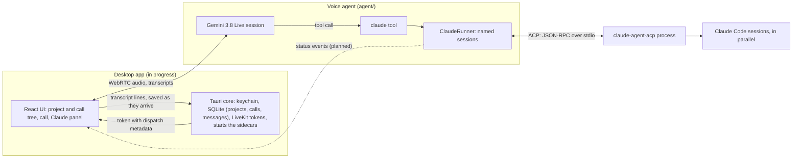

# Architecture

Claudible lets you talk to Claude Code. A desktop app holds your projects; you start a call on one, talk to a voice model, and the voice model hands real work to a Claude Code session that runs on your machine. The user brings their own LiveKit keys, Gemini key and signed-in Claude Code ([decision](decisions/users-bring-their-own-keys-and-claude.md)).

## The pieces

| Piece | Where | Status |
| --- | --- | --- |
| Voice agent | `agent/` (Python, LiveKit Agents, Gemini 3.8 Live) | Built |
| Claude runner | `agent/tools/claude.py` (ACP client driving `claude-agent-acp`) | Built |
| Desktop app | `app/` (Tauri v2, React, LiveKit Agents UI) | Shell, settings (setup checks, LiveKit and Gemini keys in the keychain), projects, calls with saved transcripts built; runs the agent from source in dev. See [roadmap](roadmap.md), [app/README.md](../app/README.md) |
| App data | One SQLite db in the app data folder, owned by the core: projects, calls, messages | Decided, see [decision](decisions/app-data-in-one-sqlite-db.md) |
| Packaging | The agent and the adapter as Tauri sidecars, run with the user's own `claude` | Proposed, prototypes first ([decision](decisions/ship-the-agent-and-adapter-as-sidecars.md)) |
| LiveKit server | LiveKit Cloud or self-hosted; not needed for `just agent console` | External |



## A call, start to end

1. **Start.** "Start a call" on a project: the core makes sure the agent worker runs (started with the keys from the keychain and the user's `claude`, registered with LiveKit as `claudible`) and records the call in SQLite (`open_call`). The page's LiveKit session then asks for a token (`call_token`, which only reads): a new room whose configuration dispatches `claudible` with the project and its folders as job metadata. The agent's entrypoint reads the metadata (`ctx.job.metadata`) into a `Project`.
2. **Talk.** Gemini 3.8 Live handles speech both ways. Its instructions are `agent/prompts/voice.md`.
3. **Work.** When the user asks for real work, Gemini calls the `claude` tool. The tool's first `ctx.update()` makes it a background task, so Gemini keeps talking.
4. **Claude.** `ClaudeRunner` starts one `claude-agent-acp` process for the call, on the first task. Gemini names a session per piece of work: a new name opens a new Claude session, a known name continues it with its context. Sessions run in parallel.
5. **Result.** When Claude's turn ends, its final message is the tool result. Gemini reads it out. Nothing else from Claude reaches the conversation.
6. **Saved.** Every transcript line goes from the page to the core as it arrives and is upserted into `messages` by its LiveKit segment id. A past call replays from there, in the same transcript component.
7. **End.** When the room disconnects (the user leaves, the room closes, the agent fails), the page tells the core, which stamps `ended_at`; the agent closes every Claude session and the adapter. The worker stays up for the next call and stops when the app quits.

## Data the app keeps

Everything lives in the app data folder (`~/Library/Application Support/com.aburady.claudible` on macOS):

- `claudible.db`, SQLite, owned by the core: `projects` (name, folders), `calls` (per project, start and end), `messages` (per call: who spoke, text, time; later Claude tasks and results). LiveKit keeps no transcripts, so the app writes each line as it arrives.
- Secrets are not here: LiveKit URL, key and secret, and the Gemini key, sit in the OS keychain.
- The sidebar is the tree of this data: projects, each with its calls ([decision](decisions/sidebar-tree-of-projects-and-calls.md)).

## Contracts

**Job metadata** (app to agent, JSON in the dispatch, up to 512 KiB):

```json
{
  "project": "samba",
  "folders": ["/Users/me/Dev/samba", "/Users/me/Dev/shared"],
  "voice": "Charon",
  "history": [{"role": "user", "text": "fix the login"}, {"role": "agent", "text": "Claude's on it."}]
}
```

- `folders` are absolute. The first is Claude's working directory; the rest are added as extra directories (ACP `additionalDirectories`).
- All fields are optional. No folders means the home folder; no name means `home`; no voice means `GEMINI_VOICE` or Charon (`settings.rs` holds the user's choice of Gemini's 30 prebuilt voices). `history` is only there when the user resumes a call: its last 50 lines, which the agent appends to its instructions ([decision](decisions/resume-a-call-with-its-last-lines.md)).
- Console runs have no metadata; `CLAUDE_PROJECT` and `CLAUDE_FOLDERS` in `agent/.env` stand in.
- Bad metadata (not an object, `folders` not a list, a relative, `~` or missing folder) fails the call at start.

**The `claude` tool** (Gemini to Claude):

- `claude(task, session)`: the user's request with every detail, and a short session name for the piece of work (normalized to lowercase with dashes).
- New name: a new Claude session opens, in parallel with any others.
- Known, idle session: the task becomes a new prompt turn in it; its final message is the result.
- Known, busy session: the task is steered into the running turn (`_session/steering`) and the call returns at once with a note saying so; the running turn's result covers both. If the adapter can't steer, the task waits for that turn and then runs as its own.
- Cancelling the tool (`lk_agents_cancel_task`) stops that session's turn and keeps the session.

**Claude's environment**: the shell environment minus `agent/.env` keys, `ANTHROPIC_API_KEY`, `ANTHROPIC_AUTH_TOKEN` and `CLAUDECODE`. Claude bills the Claude plan login. Sessions run in `bypassPermissions` mode with Claude's own settings, hooks and `CLAUDE.md` files loaded.

## Where the details are

- Why things are this way: [decisions/](decisions/)
- ACP and adapter behavior: [acp-notes.md](acp-notes.md)
- LiveKit behavior: [livekit-notes.md](livekit-notes.md)
- Gemini behavior: [gemini-notes.md](gemini-notes.md)
