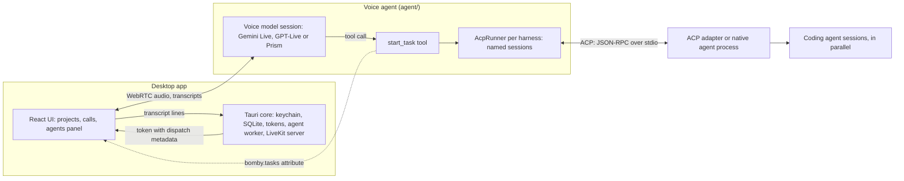

# Architecture

Bomby is a desktop app for talking to coding agents. A call connects a voice model the user picks, Gemini Live, OpenAI's GPT-Live or Rime's Prism, to an agent installed on the user's machine ([decision](decisions/voice-providers-like-harnesses.md)). The user brings that provider's key and their own agent ([decision](decisions/users-bring-their-own-keys-and-claude.md)); calls run through LiveKit on their Mac, or their own LiveKit Cloud project ([decision](decisions/livekit-on-this-mac-or-cloud.md)).

## The pieces

| Piece | Where | Status |
| --- | --- | --- |
| Voice agent | `agent/`: Python, LiveKit Agents, Gemini 3.8 Live, OpenAI GPT-Live or Rime Prism (`voice_providers/`) | Built; GPT-Live is new and untried on calls ([notes](openai-notes.md)); Rime is Experimental: tried on the owner's calls with a workaround for its LiveKit plugin ([notes](rime-notes.md)) |
| Harnesses | `agent/harnesses/`: Claude Code, Codex, OpenCode, omp and goose; shared ACP client and runner in `agent/acp_client/`; one voice tool, `start_task` | Built |
| Desktop app | `app/`: Tauri v2, React, LiveKit Agents UI; settings, projects, calls and saved transcripts | In progress; runs the agent from source in dev, the packaged agent in release builds |
| Workspace panel | `app/src/features/workspace/`, `app/src-tauri/src/workspace/`: a project folder's git changes, files and terminals beside the call, the Agents panel (`app/src/features/agent-streams/`: what each coding agent is doing, live, [decision](decisions/agent-streams-through-the-core.md)), and the panels extensions add | Built ([decision](decisions/workspace-panel-beside-the-project.md)) |
| Extensions | `agent/extensions/`, `app/src-tauri/src/extensions/`, `app/src/features/extensions/`: tool sets the agent gets on a call, on or off in Settings and per project; To-dos (`app/src/features/todos/`), Call names (`app/src/features/call-names/`), and Zapier and Composio, hosted MCP servers the user signs in to | Built, not yet tried on a call ([decision](decisions/extensions.md), [hosted MCP](decisions/hosted-mcp-extensions-with-oauth.md)) |
| App data | One core-owned SQLite database for projects, calls and messages | Built ([decision](decisions/app-data-in-one-sqlite-db.md)) |
| Packaging | The agent frozen with PyInstaller into the app's resources; adapters installed on Set up | Bundled in release builds; signed and notarized by the Release workflow ([releasing.md](releasing.md), [decision](decisions/ship-the-agent-and-adapter-as-sidecars.md)) |
| LiveKit server | Bundled `livekit-server` run by the core on this Mac (`livekit.just`, `src-tauri/src/local_server.rs`), or the user's LiveKit Cloud or own server; not needed for `just agent console` | Built |



## A call, start to end

1. **Start.** The core makes sure the call's LiveKit server runs (this Mac's, started on the first call, or the user's own) and starts or restarts the agent worker on it, while it looks for the installed agents side by side (leaving out any the setup probe found not set up; a call with none still opens, and the voice says how to get one), then records the call with `open_call`, then mints a read-only token with `call_token`. The token's room configuration dispatches `bomby` with the project, its folders and instructions, and the agents found when the call opened as job metadata; every token for the call carries the same server, agents and picks. The entrypoint reads `ctx.job.metadata`.
2. **Talk.** The call's voice provider handles speech both ways: Gemini 3.8 Live, OpenAI's GPT-Live, or Rime's Prism ([decision](decisions/voice-providers-like-harnesses.md)). Gemini can search the web with its own Google Search, and GPT-Live's response model with OpenAI's web search, each an option that's on unless the user turns it off. The instructions are the provider's prompt for the user's tone (`agent/prompts/<provider>/sharp.md`, `chatty.md` or `playful.md`) plus what the call adds, as Markdown sections for Gemini and plain sentences for GPT-Live and Rime, each part left out when it has nothing to say: the date, time and time zone when the call starts (`## Date and time`, from the Mac's clock), what to call the user (`## The user`), the agents it can use, the project, always: its name, its folders by name and, when the user wrote some, its instructions (`## Project`, so "the project" means this one) and, on a resumed call, the earlier conversation (`agent/voice_prompt.py`). GPT-Live delegates: its voice model never sees the tools, and its response model, the backend, reasons and calls them with instructions of its own (`agent/prompts/openai/backend.md`, then the date, the agents and the project; `backend_instructions`), without the user's name or what memory knows ([notes](openai-notes.md)).
3. **Work.** The voice model (GPT-Live's backend) calls `start_task(task, session, agent)`. Its first `ctx.update()` makes the tool non-blocking, so the conversation continues.
4. **Agent sessions.** Each selected harness gets one `AcpRunner` and one ACP process per call, started on its first task. A new session name opens a session; a known name continues it. Sessions run in parallel, and supported harnesses accept steering mid-turn.
5. **Result.** The agent's final message becomes the tool result. The voice model reads it out (on GPT-Live, LiveKit gives the late result to the voice model as context and asks it to speak; [notes](openai-notes.md)); no other agent output reaches the voice conversation.
6. **Saved.** The page sends each transcript line to the core as it arrives. The core upserts it by LiveKit segment id, and saved calls replay through the same transcript component.
7. **End.** Room disconnect stamps `ended_at`; the agent closes its sessions and ACP processes. The worker stays warm until the app quits.

## Data the app keeps

The app data folder (`~/Library/Application Support/app.bomby.desktop` on macOS) holds `bomby.db`: `projects` (each with its folders in order, `project_folders`, and what its calls may use, `project_agents` and `project_extensions`), `todos` (each project's to-dos), `calls` (each with its name, null until named), `call_sessions` (each opening or resume of a call, from its start to its end), `messages` (each with its session, and `messages_search`, an FTS5 index over their text by trigrams, kept current by triggers), `settings`, and the settings picked for each agent (`agent_picks`). `search(query)` (`src-tauri/src/search.rs`, for the command palette, [decision](decisions/command-palette-with-full-text-search.md)) finds projects and calls whose name has every word (compared through `fold()`, a SQL function the core adds: lowercase in any script, accents taken off), and calls with a line that has every word of three characters or more, any case and accents aside: up to 8 projects, those starting with the query first, and up to 20 calls, the latest first, each with its first matching line cut around the match, if one matched. `rename_call(callId, name, by)` names a call (`by` being `user` or `bomby`; no words take the name away) and sends `call-renamed` (`{ projectId, callId }`) to every window; `call_transcript(callId)` answers `{sessions, messages}`, which the transcript shows with a divider over each session ([decision](decisions/call-names-and-sessions.md)). LiveKit does not retain transcripts. Secrets stay in the OS keychain. The sidebar renders the project-and-call tree ([decision](decisions/sidebar-tree-of-projects-and-calls.md)).

## Contracts

**Job metadata** (app to agent, JSON in dispatch, up to 512 KiB):

```json
{
  "project": "samba",
  "folders": ["/Users/me/Dev/samba", "/Users/me/Dev/shared"],
  "instructions": "A music app: the API is in Go, the site in Svelte.",
  "agents": {"claude": "/Users/me/.local/bin/claude", "opencode": "/Users/me/.opencode/bin/opencode"},
  "agents_off": false,
  "picks": {"claude": [{"setting": "model", "value": "opus"}], "opencode": [{"setting": "model", "value": "provider/model-id"}]},
  "provider": "gemini",
  "provider_options": {"google_search": true},
  "voice": "Leda",
  "user_name": "Sam",
  "tone": "chatty",
  "memory_user": "bomby-0123456789abcdef",
  "memory_incognito": false,
  "history": [{"role": "user", "text": "fix the login"}, {"role": "agent", "text": "Claude's on it."}],
  "extensions": {"todos": {"open": [{"number": 6, "title": "Rewrite the onboarding copy", "status": "todo"}], "more": 0}, "call_names": {"name": "Login flow", "namedBy": "user"}}
}
```

- All fields are optional; one sent as null counts as left out, and unknown fields are ignored. `folders` must be absolute, existing paths, and a project may have none; the first is the working directory and the rest become ACP `additionalDirectories`. Defaults are the home folder, project `home`, provider `gemini`, and the provider's console voice (`GEMINI_VOICE`) or its default (Leda).
- `instructions` is what the user wrote about the project in its settings, up to 5,000 characters; empty when they wrote nothing, and then neither the voice model nor the coding agents hear of it.
- `agents` maps installed harness ids to programs: all but those the setup probe found not ready (one not probed yet stays), and only those the project lets its calls use (Project settings, Agents; [decision](decisions/agents-per-project.md)). `agents_off` is true when the user turned the project's agents off: the voice says so, and where to turn them on. The voice model can use only agents in this list; console runs find them on PATH ([decision](decisions/detect-acp-native-agents.md)).
- `picks` holds the session settings the user picked for each agent, if any (model, effort, goose's provider), which the runner applies to every session it opens with `session/set_config_option`, in the agent's own order (provider before model). One the agent no longer offers, or refuses, is skipped, leaving its default; for an agent whose harness requires a model pick, a session without one fails the task (`no_model_picked`) ([decision](decisions/pick-agent-settings-like-buzz-and-zed.md)).
- `memory_user` is the install's Zep user when Settings, Memory is on and a Zep key is saved, and empty otherwise; the worker runs with `ZEP_API_KEY` whenever a key is saved, so the switch never restarts it ([decision](decisions/memory-across-calls-with-zep.md)). `memory_incognito` (Settings, Memory, Incognito) reads memory but saves nothing from the call.
- `provider` is the voice model the call talks through (`agent/voice_providers/`); an unknown one fails the call at start. `provider_options` holds what the user set for it, by option id: a switch's `true` or `false` (Gemini's `google_search`), a choice's value (GPT-Live's `"response_model": "gpt-6-luna"`, `"reasoning_effort": "medium"`); the rest take the provider's defaults, unknown ids and values a choice doesn't have are ignored, and a value of the wrong kind fails the call at start ([decision](decisions/voice-providers-like-harnesses.md)).
- `tone` is `sharp` (the default), `chatty` or `playful`, from Settings, Bomby; an unknown one is `sharp` ([decision](decisions/tones-as-whole-prompts.md)).
- `user_name` is what the user asked to be called in Settings, Bomby, up to 50 characters; empty when they'd rather not say, and then the prompt doesn't mention a name. Only the voice model gets it, and the user's own Zep project when memory across calls is on; never the coding agents ([decision](decisions/the-users-name-only-for-the-voice.md)).
- `history` appears only when resuming a call and contains its last 50 lines ([decision](decisions/resume-a-call-with-its-last-lines.md)).
- `extensions` holds the extensions the call has (Settings, Extensions, or the project's own choice), by id, each with what it needs at the start: for `todos`, up to 30 open to-dos, the newest first, and how many more are open; for `call_names`, the call's name and who gave it, both null until it has one. One the agent doesn't have is ignored ([decision](decisions/extensions.md)).
- The agent reads and checks it once against one typed contract (`JobMetadata` in `agent/job.py`, pydantic); the project, the installed agents, the picks and the call options each take their fields from that. Console runs use `VOICE_PROVIDER`, `BOMBY_PROJECT`, `BOMBY_FOLDERS`, `BOMBY_INSTRUCTIONS`, `BOMBY_USER_NAME` and `BOMBY_TONE` from `agent/.env`. Invalid metadata fails the call at start.

**`start_task`** ([decision](decisions/one-tool-for-every-agent.md)):

- `task` is the full request; `session` is a short name normalized to lowercase with dashes; `agent` is an `AgentName` matching `HARNESSES`.
- New names open parallel sessions. Idle sessions start another prompt turn. Busy sessions take `_session/steering` where supported: the call stays open until the running turn ends, then returns a note beside that turn's result, which covers both. A result always means the work is done. Otherwise the task waits for the running turn and runs after it.
- Cancelling with `lk_agents_cancel_task` stops the turn but keeps the session.
- The user can stop a task from the agents panel (`bomby.tasks.stop`, under Tasks): `start_task` then returns "<name> stopped the task." ("The user" without a name) as its result, not an error, so the voice model doesn't apologise or retry.

**Extensions** ([decision](decisions/extensions.md)). Each extension's tools reach the app over LiveKit RPC: method `bomby.<extension>.<op>` on the room's `user` participant (the page), a JSON payload, a JSON answer; a refusal is `RpcError` code 2000 with the message the voice model hears (`agent/extensions/bridge.py`). Any other failure tells the voice model that nothing changed when the page never ran the request (no such participant or method, never sent), and otherwise (a timeout, the page leaving, a failed handler) that it may have, to read the list again before retrying. The to-dos' methods:

- `todos.list` `{status}` (`open`, `all`, `todo`, `doing`, `done` or `cancelled`) answers `{todos, omitted}`: the to-dos, oldest first, and how many older ones were left out to fit, which Bomby says;
- `todos.add` `{items: [{title}]}`, at most 20, answers with those added, each `todo`;
- `todos.update` `{number, status?, title?, notes?}` answers with the to-do as it is now;
- `todos.remove` `{number}` answers with the to-do removed.

A to-do is `{number, title, notes, status, ...}`; the agent reads those four and ignores the rest. Call names' one method, `call_names.set` `{name}`, renames the call it's on and answers `{name, namedBy}` ([decision](decisions/call-names-and-sessions.md)).

The core keeps them (`src-tauri/src/extensions/`): `extensions_settings()` lists each extension from the agent's catalogue (`src-tauri/extensions.json`, written by `just agent extensions`) with whether Settings has it on, `set_extension(id, on)` changes that and sends `extensions-changed`, and `set_project_extensions(id, { own, on })` makes a project follow Settings or pick its own (`on` is null until it first picks, so only then does picking start from Settings'; a pick of none stays none). `open_call` fixes the call's extensions; each token's metadata reads what they need fresh, so a reconnect starts from the list as it is. `list_todos(projectId)`, `add_todos(projectId, items, by)`, `update_todo(projectId, number, change, by)` and `remove_todo(projectId, number)` keep a project's to-dos, `by` being `user` or `bomby`; each change sends `todos-changed` (`{ projectId }`) to every window. On the page, `ExtensionRpcBridge` registers every extension's methods on the session's room for as long as the window lives, and answers only the room's agent participant, about the active call and its project (`features/extensions/`); each extension's handlers call the same commands the user's do, as `bomby` (`features/todos/rpc.ts`). An answer keeps under 14,000 bytes: a long listing leaves out its oldest to-dos. The user's own changes use the same commands from the To-dos panel beside the project (`features/todos/`), which every window keeps current from `todos-changed`. Numbers come from the project's own count and are never reused; a title is 1 to 120 characters, notes up to 1,000 (the page counts down to both, `features/todos/limits.ts`), and a refusal is a message for the user ("There's no to-do number 9.").

**Hosted MCP extensions** ([decision](decisions/hosted-mcp-extensions-with-oauth.md), [notes](mcp-notes.md)). Zapier and Composio are a vendor's MCP server each, whose catalogue entry carries `connect` (`mcp_url`, `manage_url`, `link_hosts`; null for the others). `extensions_settings()` gives each a `connection` (`connected`, `connecting` while a sign-in is under way, `account`, `manageUrl`, never a token). `connect_extension(id)` signs in to the vendor in the browser (discovery, dynamic registration, PKCE, a loopback redirect on `127.0.0.1`, `src-tauri/src/extensions/oauth.rs`) and keeps the grant in the keychain entry (`grants`, by id), resolving when the user finishes; `cancel_extension_connect(id)` stops it and `disconnect_extension(id)` forgets the grant; each change, and a sign-in starting or ending, sends `extensions-changed`. Discovery checks every address is HTTPS, follows no redirects, and requires the resource and issuer metadata to name the MCP server and the authorization server, S256 PKCE, and the right `iss` on the browser's return when the server sends one. A call has one only once it's connected (`on_for`). The worker gets its access tokens from the core over a Unix socket in a folder only the user can open, its path in `BOMBY_TOKENS` and the run's secret in `BOMBY_TOKENS_SECRET`: one line of JSON each way, `{"secret", "extension", "stale"}` to `{"token", "expires_in"}` or `{"error"}` (`src-tauri/src/extensions/tokens.rs`, `agent/extensions/tokens.py`). The core refreshes a token that's `stale` or about to expire under that extension's own lock, which Connect's save and Disconnect take too, and saves it only if the grant it started from is still the saved one; only a refresh the vendor answers with `invalid_grant`, `invalid_client` or `unauthorized_client` removes the grant. The agent loads the server's tools as an `MCPToolset` with a bearer token it swaps before expiry and once on a 401 (`agent/extensions/hosted_mcp.py`), plus `open_<id>_link`, which asks the page over RPC (`<id>.open_link`, `{ url }`) to have the core open a link on the vendor's hosts (`open_extension_link(id, url)`).

**Briefing.** Each session receives `prompts/harness-briefing.md` plus the project name, folders and instructions once (never again with follow-ups or steering): through the system prompt when supported, otherwise before its first task. It requires a short, plain-text, outcome-first final report for speech.

**Agent errors.** A harness that fails fails the task with one short line for the voice model, "<agent> isn't ready right now" or "<agent> stopped before finishing", plus an instruction to say sorry and offer another agent (`not_ready` and `stopped` in `agent/acp_client/runner.py`, owner's choice, 2026-11-04). A turn that ends without a final message fails the same way ("<agent> ended without reporting back", `no_report`), so it never reads as done. Starting an adapter (spawning it and `initialize`) and opening a session (`session/new`, its mode and the picks) each get 30 s, as long as the setup probe gives them (`START_TIMEOUT_S`): one that doesn't answer in time fails the task as not ready, its process is stopped, taking any other sessions in it, and the next request starts a fresh one. A call that ends meanwhile stops waiting at once. The details go to `agent.log`; Settings shows what to fix, from the setup probe ([decision](decisions/check-agent-setup-with-an-acp-probe.md)).

**A crashed job.** When a call's job raises, livekit-agents logs `unhandled exception while running the job task` with the job's `room` (`bomby-<call id>-<ms>`). The core reads it from the worker's output (`job_crash` in `src-tauri/src/agent.rs`) and sends `call-agent-crashed` (`{ room, reason }`) to the main window, which fails the call at once if it's in that room (a resumed call joins a new room, so a late crash from an earlier one is ignored) instead of waiting out the 30 s join timeout (`call-provider.tsx`): the page says "Bomby couldn't start the call. Try again?" and the reason goes to `app.log`. A folder that's gone is caught before the call starts (`open_call`), so it never gets that far.

**A call the voice model ends.** When the voice model's service fails for good (no credits left, a key that stopped working), LiveKit closes the agent's session after three errors in a row but leaves the agent in the room, so the page would go on showing a call nobody answers. The agent sets the `bomby.failure` attribute on its participant to one line of at most 300 characters (`agent/call_failure.py`): "<service> ended the call: <the service's own message>" when the service gave one in the 30 s before, else "<service> ended the call. Check your key and your account with <service>, then try again." The page shows the line on the project's page and ends the call (`features/call/call-failure.ts`, `EndOnAgentFailure`); a call's first failure is the one shown ([notes](livekit-notes.md#how-the-app-makes-a-call)).

**The LiveKit server.** Settings, Call server and the splash choose it with `livekit_server()` and `set_livekit_server(server)` (`thisMac` or `theirs`; until chosen, `theirs` when the user's keys are saved), which also sends `keys-changed` (`src-tauri/src/call_server.rs`). This Mac's runs from the bundled sidecar on 127.0.0.1 with free ports and keys made at each start, given through `LIVEKIT_CONFIG` and `LIVEKIT_KEYS`; it logs to `livekit.log`, stops with the app or when calls move to the user's own, and its pid in `livekit-server.pid` lets the next launch stop one a killed run left (`src-tauri/src/local_server.rs`).

**Voice providers.** `voice_settings()` lists each provider with whether its key is saved, its voice and voices, and its options, plus the one picked (`src-tauri/src/voice.rs`). What each provider is (its name, key variable, voices, default voice and options: switches and choices, with their defaults and, for a choice that follows another, its values for each of that one's) comes from the agent's definitions: `just agent providers` writes them to `src-tauri/voice-providers.json`, which the core embeds, and `just agent check` fails when that file is out of date. Until the user picks one, it's the first with a saved key (so an install with a Gemini key stays on Gemini), else Gemini, saved once worked out. `set_voice_provider(provider)` sends `keys-changed`; `set_voice(provider, voice)` and `set_voice_option(provider, option, value)` (a switch's `true` or `false`, or a choice's value, which must be one it has now) keep each provider's own; `save_voice_key(provider, key)` and `clear_voice_key(provider)` keep the keys in the keychain entry. There is always a pick, and `open_call` refuses a call without its key, the worker runs with every saved key (`GOOGLE_API_KEY`, `OPENAI_API_KEY`, `RIME_API_KEY`) so a new pick never restarts it, and the call keeps the provider, voice and options it opened with on every token ([decision](decisions/voice-providers-like-harnesses.md)).

**Memory across calls.** With `memory_user` and `ZEP_API_KEY`, the agent reads Zep's summary and facts about the user while the room connects, within 5 s, before Gemini connects (`## What you remember` in the voice prompt), adds `recall_about_user`, and saves every line to a Zep thread in the background, in the order it was said, the rest on hang-up (`agent/memory.py`). The Zep user carries the name from Settings, Bomby and the Mac's time zone. When Zep can't be reached the call goes on without memory and the agent sets `bomby.memory` to `unavailable`, which the call view shows as a card. Settings, Memory turns it on (`memory_setting`, `set_memory_setting`), sets incognito (`memory_incognito`, `set_memory_incognito`) and keeps the key (`has_zep_key`, `save_zep_key`, `clear_zep_key`).

**Menu bar.** The main window's page reports `set_tray_status({ state, call, starting, recent, blocked })` whenever the call changes; End call is offered only once the call has started (`features/tray/tray-bridge.tsx`); the core draws the icon and menu from it (`src-tauri/src/tray.rs`) and sends `tray-start-call` (a project id) and `tray-end-call` back to the main window. Closing the main window hides it, so a call keeps running.

**Tasks.** The voice agent publishes the call's latest 20 tasks as the `bomby.tasks` attribute, each request shortened to 160 characters (`agent/task_board.py`). Opening one in the agents panel asks the agent for its full request over RPC, `bomby.tasks.request` with the task's id as the payload, answered with the words Bomby sent the agent (cut at 14,000 bytes); the agent answers only the page, and refuses with code 2000 a task it no longer keeps (`features/call/tasks.ts`). Stop stops one, `bomby.tasks.stop` with the task's id, answered with an empty string, again only for the page (`TaskBoard.stop`; the page's Stop, in a task's row and dialog, sends each once and shows the refusal's message as an error toast, `features/call/task-stops.ts`): a queued task is dropped before it starts; a working one stops its whole turn (ACP `session/cancel`, the session stays), so every request steered into it stops too, since a request can't be taken back once the agent has it; each shows `stopped`. A task that has already ended is refused with code 2000, "That task has already ended.", and one no longer kept with "That task isn't kept anymore."; nothing changes.

**Agent streams** ([decision](decisions/agent-streams-through-the-core.md)). While a turn runs, the voice agent sends what its coding agent does to the core over a Unix socket (`BOMBY_STREAMS`, with the run's secret in `BOMBY_STREAMS_SECRET`; `agent/acp_client/streams.py`). One connection per call; each line is JSON: first `{"secret", "room"}`, then events, each with the call's `stream` (one per turn of a session): `start` (`agent`, the harness id, `name`, its short name, and `session`), `text` (`message`, the ACP message id or null, and `text`, which appends to that message), `tool` (a patch by `id` of `title`, `kind` and `status` as ACP sends them: `pending`, `in_progress`, `completed`, `failed`), `dropped` (events before it were left out) and `end`. The core adds `at` to `start` and `end`: when it got them, in ms since 1970. The agent reads only those standard fields, cuts titles at 200 characters and a message at 16,000, batches text for 100 ms, and drops events rather than wait; `start` and `end` are always sent. The core (`app/src-tauri/src/agent_streams.rs`) reads the call id from the room's name, prefixes each stream with its connection, holds the call's streams in memory, the finished ones too (pieces of one message joined, about 1 MiB a stream, the oldest after its `start` dropped for a `dropped` marker; at most 16 running at once, and about 8 MiB and 256 turns a call, past which its oldest finished turns go), and drops them when the connection closes, which is the call ending and first ends its running streams. It reads lines of at most 256 KiB, skips one it can't read, and logs none. The page follows a call with `watch_agent_streams({ callId, events })`, a `Channel<StreamEvent>` (`generated/agent-streams.ts`) that gets the held events, finished turns included, and then each one as it comes, and stops with `unwatch_agent_streams({ id })`. The page's Agents panel (`features/agent-streams/`) reduces the events (`streams.ts`): text joins the message it continues unless the ids differ, a tool event patches the line with that id or starts one, an unknown status reads as running, `dropped` leaves one marker, a `start` in an agent and session already listed continues its row, and `end` closes every open tool call and leaves the row, finished, until the call ends.

**Notifications.** The main window's page watches `bomby.tasks`; when a task it saw `working` turns `done` or `failed`, it calls `task_finished({ projectId, agentName, session, status, task })` (`features/notifications/task-notifier.tsx`). The core notifies only when no Bomby window is focused ("Claude's done · fix-login", the task as the body), and a click sends `open-project` back (`src-tauri/src/notifications.rs`).

**Updates.** Settings, About reads `about()` (the version and an update status) and follows `update-status` events, sent to every window (`features/about/`). Release builds check once at launch; `check_for_updates()` checks again and `install_update()` downloads, installs and restarts. It never cuts off a call: the core tracks calls under the update's own lock (`open_call` registers one, `end_call` forgets it), so installing is refused while one is on, a call that starts during the download leaves the update `downloaded` until the user restarts, and `open_call` refuses new calls once Bomby is restarting (`src-tauri/src/updates.rs`). Updates come from the latest published GitHub release's `latest.json` ([releasing.md](releasing.md)).

**Diagnostics.** Settings, About's Export diagnostics calls `export_diagnostics()`, which zips every log Bomby writes (`app.log`, `agent.log`, `livekit.log` and any other `*.log` in the app's log folder, and the adapters' `install.log`; the names are each writer's `LOG_FILE`) with a `diagnostics.txt` (version, build, macOS version, architecture, when, which logs were missing, and notes on a log or log folder that couldn't be read) into "Bomby Diagnostics YYYY-MM-DD HH-MM.zip" on the Desktop (" 2" and on when the name is taken), shows it in Finder and returns its name; `show_diagnostics()` shows the last one again, so the page never sends a path. The command is async and runs the export on a blocking thread; the core runs one export at a time (`Exports`), and each writes its own hidden temporary file (created exclusively) and hard-links it to the first free name, so it never replaces a file. A missing log is skipped, a log over 8 MiB keeps its end. Every log is redacted on the way in by one `Redactor` built per export: every key, secret and token the core held this run, current or since replaced, cleared or disconnected (the vault's private redaction history, `Vault::secrets_this_run`, and every local LiveKit server secret, `LocalServer::secrets_this_run`), word for word and JSON-escaped; then anything shaped like a key or token (JSON Web Tokens, `AIza` and `sk-` keys, 64-character hex, `Bearer`, and `name=value`, `"name": "value"` and its JSON-escaped form inside a JSON log line, where the name says key, secret, token or password; a quoted value goes whole, escaped quotes inside it included, up to three JSON strings deep, and only counters such as `prompt_tokens` keep a number). That is all it promises: the rest is as logged, and `diagnostics.txt`, the page and the bug template ask the user to look the logs over before sharing them publicly. A zip saved that Finder can't show is still saved: the command returns its name with `finderError`, the page keeps "Saved <name>" and shows that error under it, and the cause goes to `app.log`, as for `show_diagnostics()`. The page keeps the export's state in a page-wide store (`features/about/use-diagnostics.ts`), so leaving About mid-export loses nothing. A failure goes to `app.log`; the page gets one line for the error card (`src-tauri/src/diagnostics.rs`).

**Workspace panel.** Every command names a project and one of its folders (`projectId`, `folder`), which the core checks is the project's and still there (`src-tauri/src/workspace/`). `folder_info` says whether it's in a git repository and on which branch; `folder_changes` lists what differs from HEAD, each file with its status (untracked apart from added; a file a merge left conflicted as `conflicted`, its patch the working file with its markers against the last commit), counts and own unified patch, and the folder's place in the repository (`within`), so the tree can match paths (null outside git, which the page doesn't ask once `folder_info` says so); `folder_entries(dir)` lists one directory, folders first, with what git ignores marked; `folder_file(file)` reads up to 512 KB for the preview, or says the file is an image (PNG, JPEG, GIF, WebP, AVIF, BMP, ICO, SVG, up to 20 MB) and its media type; `folder_image(file)` then sends its bytes raw, as an `ArrayBuffer`. `watch_folder(changed)` sends `null` on its channel after each burst of changes until `unwatch_folder(id)`; it also watches the repository's git folders when they're outside the folder (a folder inside a repository, a linked worktree), for the index, HEAD and the branches, and finds them when a plain folder becomes a repository while it's shown. `terminal_open(cols, rows, output, exit)` starts `$SHELL -l` in the folder, with the environment a terminal app gives its shell rather than the app's own, and streams its bytes raw on `output` (an `ArrayBuffer` per chunk), then its exit code on `exit`; `terminal_write(id, seq, data)` (text, or an array of bytes for mouse reports past ASCII), `terminal_resize(id, seq, cols, rows)` and `terminal_close(id)` drive it. The page numbers a terminal's writes and resizes together from 0, and the core applies them in that order, since the commands can overtake each other; the page sends a resize once the grid has kept one size for 60 ms. Quitting the app hangs up every shell ([decision](decisions/workspace-panel-beside-the-project.md)).

**Claude's environment.** The runner removes `agent/.env` keys, `ANTHROPIC_API_KEY`, `ANTHROPIC_AUTH_TOKEN` and `CLAUDECODE`, so Claude uses its plan login. Sessions run in `bypassPermissions` with the user's settings, hooks and `CLAUDE.md` files.

## Details

- [Decision records](decisions/)
- [ACP and adapter behavior](acp-notes.md)
- [LiveKit behavior](livekit-notes.md)
- [Gemini behavior](gemini-notes.md)
- [OpenAI GPT-Live behavior](openai-notes.md)
- [Rime behavior](rime-notes.md)
- [Zep behavior](zep-notes.md)
- [Tauri behavior](tauri-notes.md)
- [The frontend stack](frontend-notes.md)
